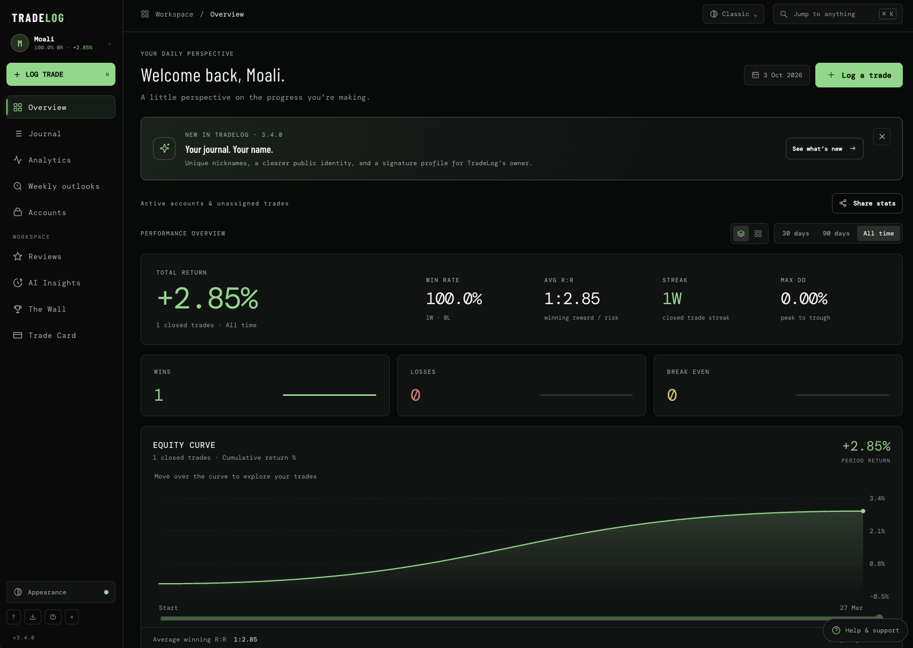
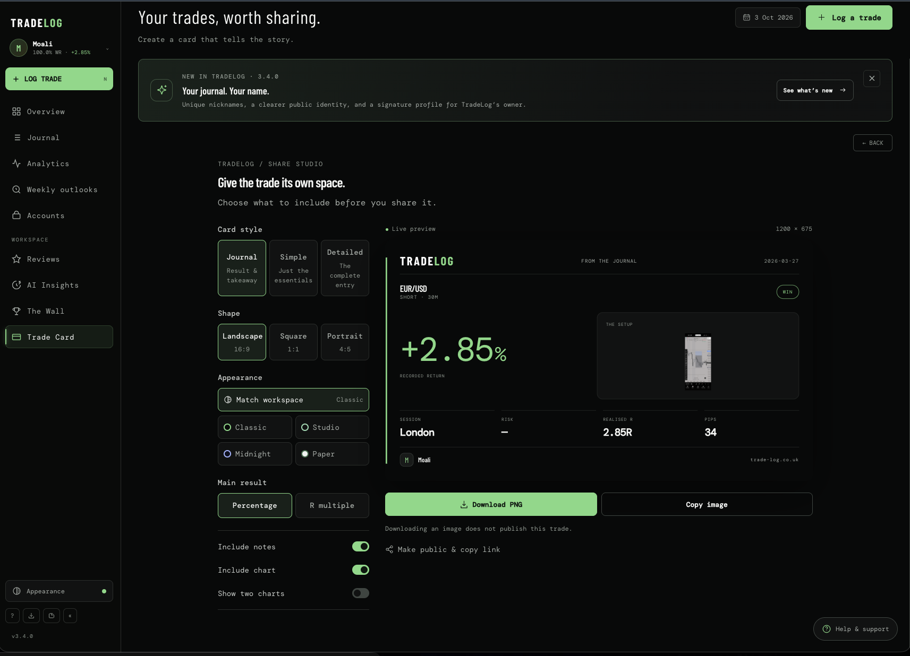
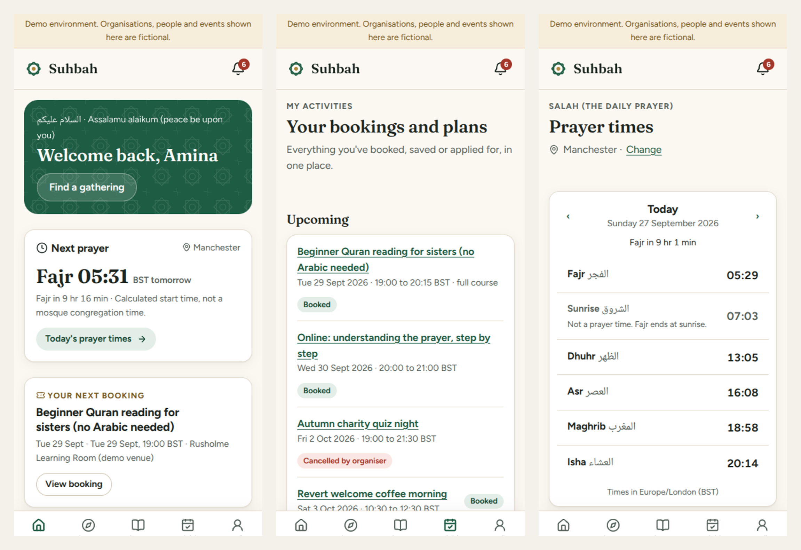
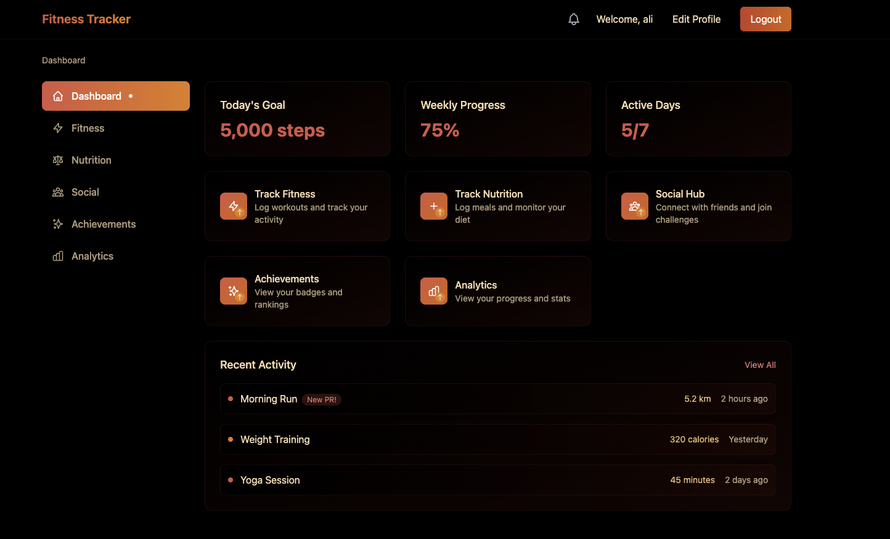

### 
I'm Ali. I build software and data solutions 👨‍💻 Manchester 🇬🇧

- 🔭 Analyst at Barclays, building Snowflake SQL reporting, automated data ingestion and Power BI dashboards
- 📈 Previously a Data Analyst for Night and Day Emergency Dentist, using SQL, GA4, Google Ads and Power BI to grow bookings
- 🔎 Before that a Junior Analyst at Seamless Ideas, working with Snowflake SQL, Python and Power BI
- 📖 MSc Financial Technology and BSc (Hons) Computer Science from the University of Salford
- 🧮 Cleaning, validation, reconciliation, segmentation, trend analysis and predictive modelling
- 📫 Connect with me on [LinkedIn](https://www.linkedin.com/in/ali-mirza02/) or at contactmomirza@gmail.com

 

# Education

| Degree | University | Key modules |
| --- | --- | --- |
| MSc Financial Technology | University of Salford | Business Intelligence Using Power BI, FinTech Data Analytics, Financial Programming and Technologies with Python, Research Methods |
| BSc (Hons) Computer Science | University of Salford | AI & Data Mining, Data Structures & Algorithms |

# Skills
To get the name of the skill, place your cursor on it.
<table><tr align="center"><td valign="top" width="33%">

### Analysis & Reporting

 

</td><td valign="top" width="33%">

### Digital Analytics

 

</td><td valign="top" width="33%">

### Engineering

 

</td></tr></table>

Also: Excel (pivot tables, lookups), KPI dashboards, data cleaning, validation, reconciliation, segmentation, trend analysis, predictive and data modelling.

# Projects

To improve the readability of my projects, here is a legend of the emojis in the title of the projects:
- :hammer_and_wrench: : software project
- :bar_chart: : data and finance project
- :books: : educational project
- :man: : personal project

- [Projects](#projects)
  - [:hammer_and_wrench: :man: TradeLog, a free trading journal](#hammer_and_wrench-man-tradelog-a-free-trading-journal)
  - [:hammer_and_wrench: :man: Suhbah, a community app for Muslim reverts](#hammer_and_wrench-man-suhbah-a-community-app-for-muslim-reverts)
  - [:bar_chart: :books: Credit risk prediction with Machine Learning](#bar_chart-books-credit-risk-prediction-with-machine-learning)
  - [:bar_chart: :books: Buy Now Pay Later and consumer financial vulnerability in the UK](#bar_chart-books-buy-now-pay-later-and-consumer-financial-vulnerability-in-the-uk)
  - [:bar_chart: :books: Portfolio analysis with clustering and Monte Carlo simulation](#bar_chart-books-portfolio-analysis-with-clustering-and-monte-carlo-simulation)
  - [:hammer_and_wrench: :books: Fitness tracking web app](#hammer_and_wrench-books-fitness-tracking-web-app)

## [:hammer_and_wrench: :man: TradeLog, a free trading journal](https://www.trade-log.co.uk/)

A free trading journal that grew to more than 100 users with no paid marketing, shared only in trading communities.

Traders log their trades and review their market bias. Performance dashboards calculate win rate, profit factor, maximum drawdown and average reward-to-risk, with date filters to help traders spot patterns.

  

It is built with JavaScript, React and Firebase and deployed on Vercel. Trade input is validated, records are stored in Firebase Firestore and traders can export their data to CSV.

Traders can also turn any trade into a card to share with others.

  

## [:hammer_and_wrench: :man: Suhbah, a community app for Muslim reverts](https://suhbah-three.vercel.app/)

Suhbah means companionship. People who are new to Islam can feel isolated even inside their own community. Suhbah helps reverts and Muslims reconnecting with their faith find welcoming local gatherings, book a place and take a manageable next step.

  

It is a mobile-first progressive web app that installs to the phone Home Screen. Manchester is the demonstration location.

What it does:
- members discover gatherings and volunteering, book a place, join a waitlist and add bookings to their calendar
- mosques, charities and teachers create and manage events and see who is attending
- an admin team reviews organisers and moderates reports
- daily prayer times, a Quran reader and push notifications for reminders

It is built with Next.js, React and TypeScript on a PostgreSQL database with Drizzle ORM. It is deployed on Vercel with Supabase and covered by 57 integration tests, 19 browser journey checks and automated accessibility scans.

You can view the live demo at [suhbah-three.vercel.app](https://suhbah-three.vercel.app/). The organisations, people and events shown there are fictional demo data.

This project is still in development so the code is private for now.

## :bar_chart: :books: Credit risk prediction with Machine Learning

For my MSc I ran a comparative study of four models for predicting credit risk:
- Logistic Regression
- Random Forest
- XGBoost
- an LSTM tuned with a genetic algorithm

The study focuses on the trade-off between accuracy and explainability. A more accurate model is not always the better choice for a lender if nobody can explain its decisions. I linked the results to the regulation that applies: GDPR Article 22, the EU AI Act and the FCA Consumer Duty.

## :bar_chart: :books: Buy Now Pay Later and consumer financial vulnerability in the UK

This is my MSc dissertation. It was awarded 73.9 out of 100, a distinction-level mark.

It asks how the growth of Buy Now Pay Later relates to financial difficulty among UK consumers, especially people who use it often.

It is a quantitative secondary analysis of the FCA Financial Lives Survey using the 2022 and 2024 waves. It covers four areas: market growth, how and how often people use BNPL, who is most vulnerable and what this means for consumer protection.

## :bar_chart: :books: Portfolio analysis with clustering and Monte Carlo simulation

A group project for my FinTech Data Analytics module. We used K-Means clustering to group assets and then built portfolios from the clusters.

My part was in two sections:
- estimating the return and risk of equal-weight portfolios across clusters using Modern Portfolio Theory, with the covariance matrix and portfolio variance
- running a Monte Carlo simulation to optimise the portfolio, with Sharpe ratio analysis, the Efficient Frontier and the Capital Market Line

## :hammer_and_wrench: :books: Fitness tracking web app

My BSc dissertation project. It is a fitness tracking web app built on the MERN stack (MongoDB, Express, React and Node.js).

  

Users can log workouts and meals, set nutrition goals and follow their progress on an analytics dashboard.

To keep people coming back I added gamification and a social side:
- points, badges, levels and streaks with a leaderboard
- friends, an activity feed and challenges
- a workout partner system with shared goals and chat

The front end is React with Vite and Tailwind. The back end is an Express API with JWT login and MongoDB for storage.

# Connect with me

 

# Certifications

LinkedIn Learning certificates of completion.

| Course | Provider | Credential |
| --- | --- | --- |
| Python for Data Analysis: Solve Real-World Challenges | LinkedIn Learning | [View certificate](https://www.linkedin.com/learning/certificates/cdddd897dacfbe02824f58b0531c80ec57a7acbfcc11cf140c183b93d1fa1a76/) |
| Python Code Challenges for Data Analysis | LinkedIn Learning | [View certificate](https://www.linkedin.com/learning/certificates/69b0808dbafdd911d9253394df3388a7da25e6b7cf2173846d0d617728fa9a91/) |
| The Role of Business Analysis in Data Analytics | LinkedIn Learning | [View certificate](https://www.linkedin.com/learning/certificates/ef920707f56580def929690107a41b144b7c30cfa3b8cb42e55460d7dbf89e9d/) |
